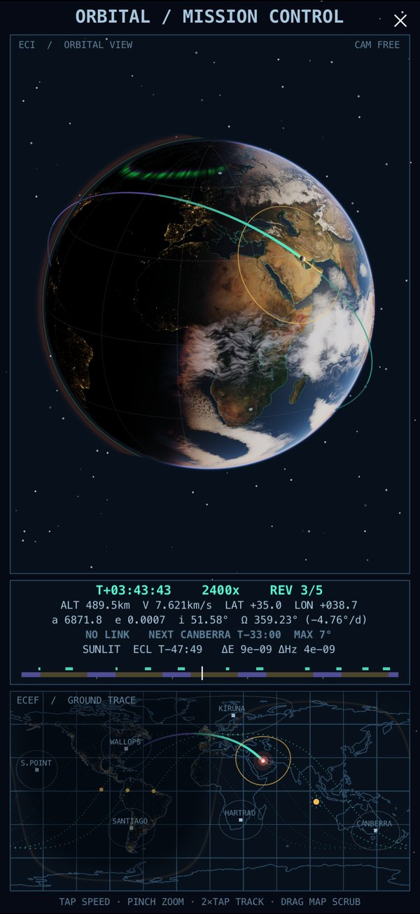
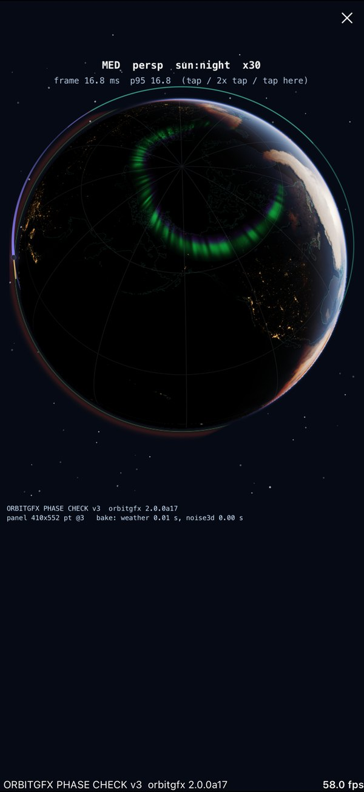
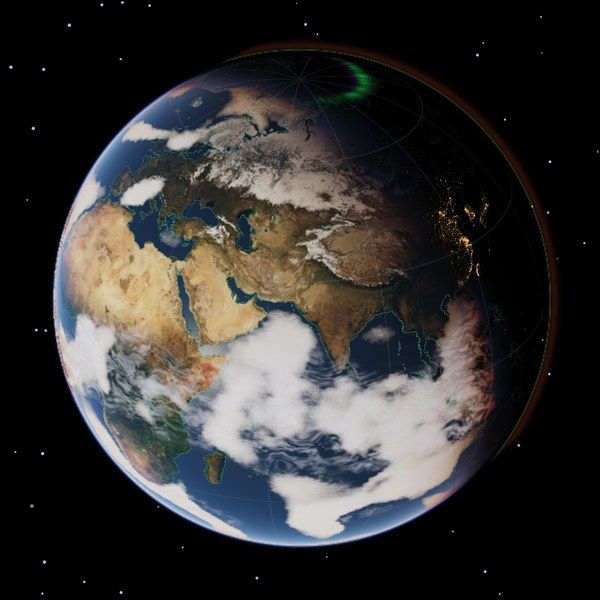
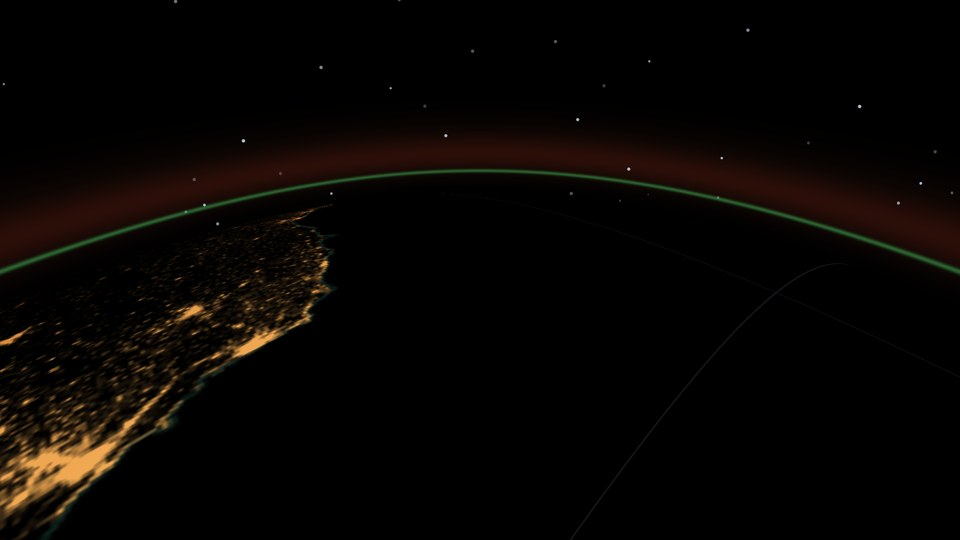
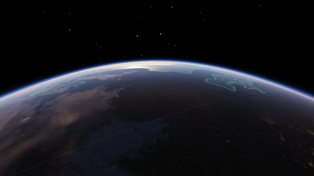
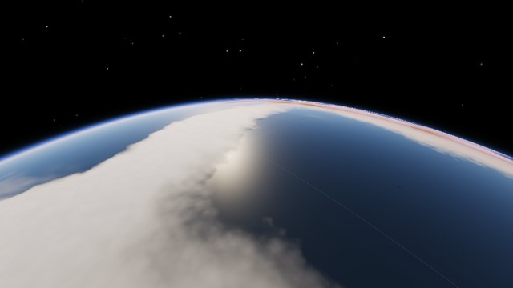
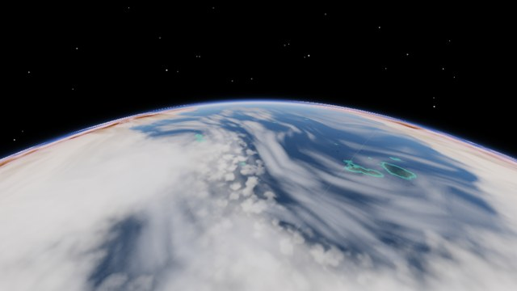
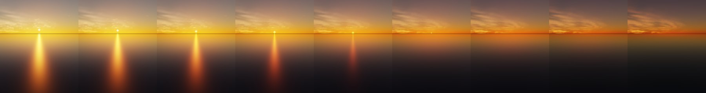
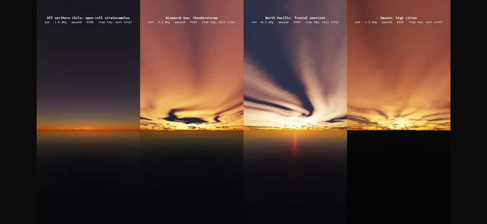
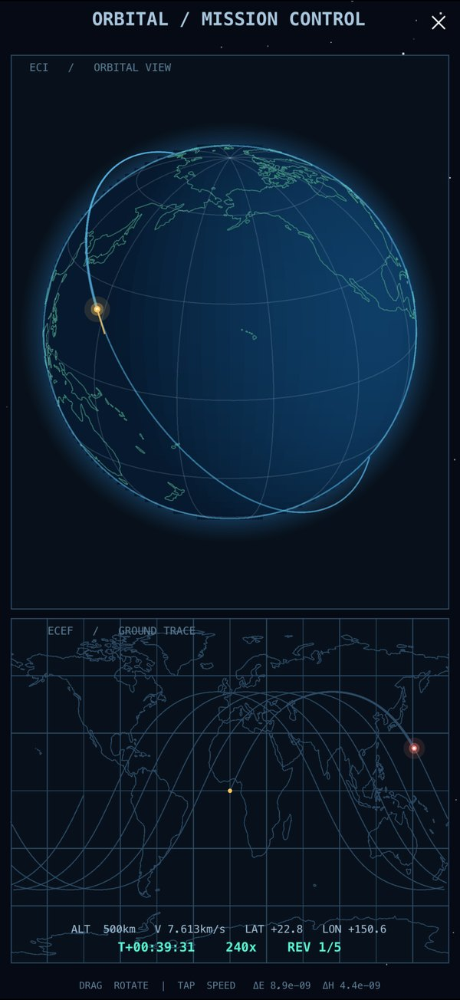

# orbitgfx

**A ray-traced Earth for Pythonista.** Nothing here is painted on. Every pixel casts a
ray into a physical model of the planet: it is intersected with the Earth, the air,
the clouds and the orbit, then marched through the atmosphere and the cloud layer,
adding up the sunlight that air molecules, aerosols and water droplets scatter toward
the camera. Sunsets are red because the light really did cross more air.

<p align="center">
  
  &nbsp;
  
</p>
<p align="center"><sub>On an iPhone 16 Pro Max: <code>examples/mission_control.py</code>, and the aurora over the night side.</sub></p>

## A planet in 20 lines

```python
import scene
from orbitgfx import GlobeView, Camera, cached_earth_image, pil_texture
from orbitgfx.astro import gmst, julian_date, sun_dir
from orbitgfx.coastlines import coastlines_xyz


class Earth(scene.Scene):
    def setup(self):
        texture = pil_texture(cached_earth_image(coastlines_xyz(6378.137)))
        self.globe = GlobeView(self, texture, quality='HIGH')
        self.globe.layout((0, 0, self.size.w, self.size.h))
        self.camera = Camera(az=-2.0, el=0.45)
        self.jd0 = julian_date()                      # now

    def update(self):
        hours = self.t * 600 / 3600                   # 600x time lapse
        jd = self.jd0 + hours / 24
        self.globe.update(self.camera, sun_dir(jd), gmst(jd), cloud_hours=hours)


scene.run(Earth())
```

<p align="center">
  
</p>
<p align="center"><sub>What it draws, here for 17 Oct 2026 10:00 UTC: the Sun where it really is
(<code>sun_dir</code>), the Earth turned by sidereal time (<code>gmst</code>), and clouds from
the weather film for that hour. <code>examples/earth.py</code>.</sub></p>

## Riding along

```python
import math
import numpy as np
import scene
from orbitgfx import GlobeView, Camera, cached_earth_image, pil_texture
from orbitgfx.astro import gmst, julian_date, sun_dir
from orbitgfx.coastlines import coastlines_xyz

R = 6378.137 + 420.0                                  # km: an ISS-like orbit
N = math.sqrt(398600.4418 / R ** 3)                   # mean motion, rad/s
INC = math.radians(51.6)


def orbit(t):
    """Position (km) and velocity (km/s) on a circular orbit, ECI."""
    u = N * t
    p = R * np.array((math.cos(u), math.sin(u) * math.cos(INC), math.sin(u) * math.sin(INC)))
    v = N * R * np.array((-math.sin(u), math.cos(u) * math.cos(INC), math.cos(u) * math.sin(INC)))
    return p, v


class Astronaut(scene.Scene):
    def setup(self):
        texture = pil_texture(cached_earth_image(coastlines_xyz(6378.137)))
        self.globe = GlobeView(self, texture, quality='HIGH', inset=0.0)
        self.globe.layout((0, 0, self.size.w, self.size.h))
        self.camera = Camera()
        self.jd0 = julian_date()

    def update(self):
        t = self.t * 10                               # 10x real time
        p, v = orbit(t)
        jd = self.jd0 + t / 86400
        self.camera.set_astronaut(p, v, down=0.3)     # ride behind it, looking down
        self.globe.update(self.camera, sun_dir(jd), gmst(jd), sat=p, vel=v,
                          cloud_hours=t / 3600)


scene.run(Astronaut())
```

<p align="center">
  
</p>
<table>
  <tr>
    <td></td>
    <td></td>
    <td></td>
  </tr>
</table>
<p align="center"><sub>Frames from <code>examples/astronaut.py</code> along one orbit. At night the
limb glows with airglow: oxygen emitting at 557.7 nm (the thin green line, ~95 km up)
and at 630 nm (the broad red band above it). At dawn the first light reaches you through
the limb, reddened. Desktop renders of the same shaders.</sub></p>

## Why the sunset is red

<p align="center">
  
</p>

Nobody chose these colours. `examples/sunset.py` stands 400 m above the sea and the
shader works out, for every pixel, how much sunlight reaches each point of air along
the view ray and how much of it is scattered toward you:

- **Rayleigh scattering** by air molecules goes as 1/λ⁴, so the shader's blue
  coefficient is 5.7 times its red one. Looking straight up you see the blue that was
  scattered out of the beam.
- **The low sun's light crosses far more air.** Integrating Beer–Lambert extinction
  along a horizontal ray from the ground through the model atmosphere keeps 11% of the
  red, 1% of the green and 0.005% of the blue. What reaches you is red, and the sun's
  own disc turns orange, then red.
- **Refraction** bends that light around the curve of the Earth: the sun is seen about
  half a degree above where it really is (Saemundsson's formula), and squashed, because
  its lower edge is lifted more than its top.
- **The clouds keep their light after the ground loses it.** A cloud top 10 km up still
  sees the sun after it has set for you; its light has grazed the dense lower air, so it
  turns orange, then pink, then grey.
- **The glint** on the sea is microfacet reflection (GGX) of that same reddened sun.

<p align="center">
  
</p>
<p align="center"><sub>Four places, four skies, on an iPhone. The clouds are not drawn for the
scene: they are whatever the weather film has over that spot at that hour.</sub></p>

## How a pixel is made

1. **Ray casting.** Each pixel's ray is intersected analytically with spheres for the
   Earth, the top of the atmosphere and the cloud shell, and with the orbit circle (the
   ring is solved exactly, so it stays a crisp line at any angle).
2. **Ray marching the air.** 6 to 16 samples along the ray through the atmosphere. At
   each one: the density of air (8 km scale height), of aerosols (1.2 km) and of the
   ozone layer (around 25 km); the sunlight still reaching that point (a precomputed
   transmittance table); and how much of it scatters toward the camera (the Rayleigh
   phase function, and the forward-peaked Cornette–Shanks phase function for aerosols).
3. **Ray marching the clouds.** Up to 56 steps through the cloud layer. From every step
   a second, shorter march toward the sun measures how much cloud is in the way, so
   clouds shade themselves and cast shadows on the ground. A two-lobe Henyey–Greenstein
   phase function gives the silver lining when you look toward the sun, and
   multiple-scattering octaves keep thick cloud bright.
4. **The surface.** NASA Blue Marble colour, Black Marble city lights that come on as
   the sun goes down, relief and mountain shadows, sea ice, GGX glint and the sky
   reflected in the water.
5. **From orbit.** The spacecraft's sunlight is traced past the Earth's limb: at eclipse
   entry the sun's disc sinks behind the Earth and its last light crosses the
   atmosphere edge-on, so the marker fades through orange and red over about 14 seconds.

The weather itself comes from a simulation run offline: a two-layer quasi-geostrophic
model of the global atmosphere, whose jet streams, fronts and midlatitude storms grow out
of the equations. Its clouds are baked into a 4-day film of 96 hourly frames.

## Quality presets

| Preset | What you get | iPhone 16 Pro Max |
| --- | --- | --- |
| `LEGACY` | the original 1.x look, kept pixel for pixel | 60 fps |
| `LOW` | physical atmosphere, lit clouds, imagery, eclipse light, refraction | 60 fps, 4 globes per frame |
| `MED` | + volumetric clouds, sky reflection on water | 60 fps, 3 globes |
| `HIGH` | + more samples, mountain shadows | 60 fps, 3 globes |
| `ULTRA` | + the most cloud steps | 60 fps from orbit; 23-27 fps on the ground |

<p align="center">
  
</p>
<p align="center"><sub><code>LEGACY</code>, the look orbitgfx started with.</sub></p>

## Getting started

1. Copy the [`orbitgfx/`](orbitgfx) folder into Pythonista's `site-packages`. It needs
   only Pythonista's built-ins (`scene`, `ui`, NumPy, PIL); the orbit solver,
   coastlines, imagery and weather film are bundled.
2. Run `orbitgfx/examples/earth.py` or `astronaut.py` (the snippets above), then
   `mission_control.py`: tap for speed, drag to orbit, pinch to zoom, double-tap to track
   the spacecraft or ride along. `sunset.py`: tap the top for the next place.
3. Everything you can tune, from the atmosphere to the cloud steps:
   [TUNING.md](orbitgfx/TUNING.md). The API: the [package README](orbitgfx/README.md).

The same code runs on a desktop in a bundled sandbox that emulates Pythonista's `scene`
with real GLSL, which is how the desktop screenshots here were made.

## How true is it?

The physics is real, the planet is idealised: the orbit is two-body plus J2, the
atmosphere is single scattering with a multiple-scattering estimate and is drawn 1.5 times
thicker than real by default so it shows at phone size, and the weather is a simple
model's, not a forecast. [VALIDATION.md](orbitgfx/VALIDATION.md) lists what is
physics, what is approximation and what is a creative choice.

## License

MIT, see [LICENSE](orbitgfx/LICENSE). Coastlines from Natural Earth; imagery from NASA
(Blue Marble Next Generation, Black Marble).
