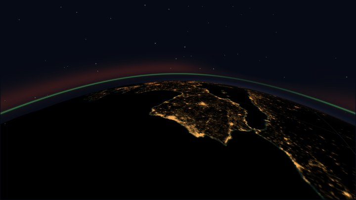
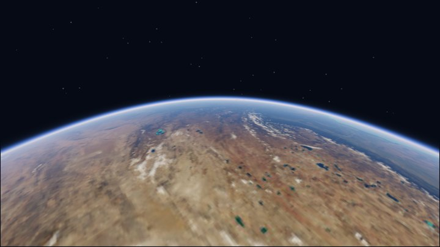

# orbitgfx

**A ray-traced Earth for your iPhone.** orbitgfx renders a physically based planet
— atmosphere, volumetric clouds from a simulated weather film, NASA imagery, city
lights, aurora, eclipses and refraction — in GLSL shaders on Pythonista's `scene`
module, plus a full mission-control demo that flies a spacecraft over it.

<p align="center">
  
  &nbsp;
  
</p>
<p align="center"><sub>On an iPhone 16 Pro Max in Pythonista: <code>examples/mission_control.py</code> and the aurora over the night side.</sub></p>

## From orbit

The astronaut camera rides just behind the spacecraft and looks ahead at the horizon.

<table>
  <tr>
    <td></td>
    <td></td>
  </tr>
  <tr>
    <td></td>
    <td></td>
  </tr>
</table>
<p align="center"><sub>Night pass with airglow · sun glint at the terminator · desert under the limb · a cloud band, backlit. Desktop sandbox renders of the same shaders (HIGH preset, camera tilted further down than the default).</sub></p>

## From the ground

`examples/sunset.py` stands on a hill and watches the sun set under whatever the weather
film has overhead. Each site shows a different kind of sky.

<p align="center">
  
</p>
<p align="center">
  
</p>
<p align="center"><sub>Four sites, then one sunset in nine frames: the disc reddens and sinks, its glint on the sea goes with it, and the clouds keep their light after the sun is gone.</sub></p>

## What's in it

- **Ray-traced globe:** one primary ray per pixel against the planet, atmosphere,
  cloud shell and orbit, in orthographic or perspective views.
- **Physical atmosphere:** Rayleigh, Mie and ozone single scattering with a baked
  transmittance table, real scale heights.
- **Weather you can watch:** a 4-day global weather film made offline by a two-layer
  quasi-geostrophic model, drawn as volumetric clouds that move, light and shadow.
- **Real imagery:** NASA Blue Marble land and Black Marble city lights, relief and
  mountain shadows, sea ice, GGX sun glint and sky reflection on water.
- **Lighting from orbit:** eclipse penumbra with the limb's red light, refraction (a
  setting sun lifted and squashed, light lingering after geometric sunset), airglow and aurora.
- **Mission control:** RK45 orbit with J2, WGS84 ground stations, AOS/LOS, Doppler,
  eclipse timeline, ground track and coverage footprint.
- **Five quality presets,** from the original 1.x look (`LEGACY`) to `ULTRA`:

<p align="center">
  
</p>
<p align="center"><sub><code>LEGACY</code>, the original look, is kept pixel for pixel.</sub></p>

| Preset | What you get | iPhone 16 Pro Max, overview |
| --- | --- | --- |
| `LEGACY` | the original 1.x look | 60 fps |
| `LOW` | physical atmosphere, 2D lit clouds, imagery, eclipse lighting, refraction | 60 fps, 4 globes per frame |
| `MED` | + volumetric clouds, sky reflection on water | 60 fps, 3 globes |
| `HIGH` | + more samples, mountain shadows | 60 fps, 3 globes |
| `ULTRA` | + the most cloud steps (experimental) | 60 fps, 1 globe |

Details, every knob and the full timing table: [TUNING.md](orbitgfx/TUNING.md).

## Quick start

1. Copy the [`orbitgfx/`](orbitgfx) folder into Pythonista's `site-packages`.
   It needs only Pythonista's built-ins (`scene`, `ui`, NumPy, PIL); the solver,
   coastlines, imagery and weather film are bundled.
2. Run `orbitgfx/examples/mission_control.py`. Tap to change speed, drag to orbit,
   pinch to zoom, double-tap to track the spacecraft or ride along.
3. Try `examples/sunset.py` (tap the top for the next site) and `examples/globe_demo.py`
   (a 40-line starting point).

```python
from orbitgfx import GlobeView, Camera
globe = GlobeView(self, texture, quality='HIGH')     # in your Scene's setup()
globe.layout((10, 10, self.size.w - 20, self.size.h - 20))
globe.update(Camera(el=0.4), sun_direction, earth_rotation)   # every frame
```

The API, layering rules and the sandbox are in the [package README](orbitgfx/README.md).

## Runs on the desktop too

A sandbox emulates Pythonista's `scene` and `ui` on a desktop with real GLSL (headless
EGL, no GPU needed) and Skia for the classic layer, so the same code renders screenshots
and runs the test suite: `pytest --pyargs orbitgfx.tests`.

## Verified on a phone

`examples/device_check.py` runs in Pythonista and checks what a desktop can't: every
preset through Apple's shader compiler, a NaN scan, the GPU's float maths against the
CPU, frame times and headroom, heat and memory, and screenshots to diff against the
desktop. `examples/device_smoke.py` runs every code path in about a minute first.

## How accurate is it?

It is a visualisation built on real physics, not an operational tool: a J2-only orbit,
mean sidereal time, a low-precision Sun, a stylised atmosphere drawn 1.5x thick by default,
and clouds from an idealised weather model. [VALIDATION.md](orbitgfx/VALIDATION.md) says
what is verified, what is approximate and what is art.

## License

MIT, see [LICENSE](orbitgfx/LICENSE). Coastlines from Natural Earth; imagery from NASA
(Blue Marble Next Generation, Black Marble).
